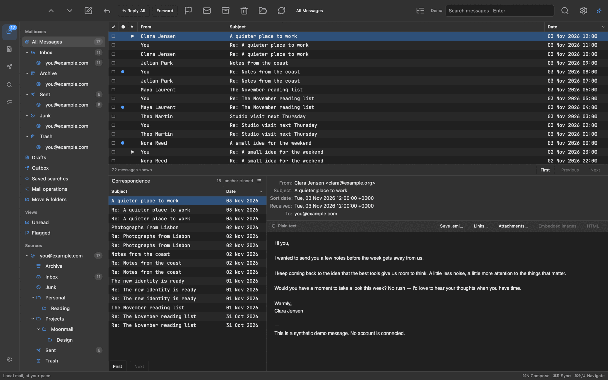
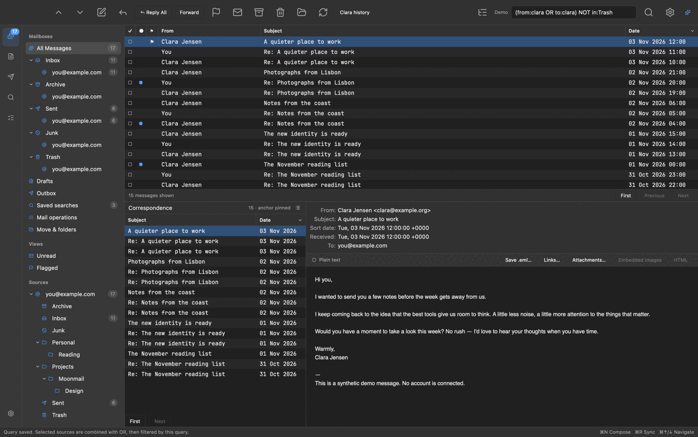
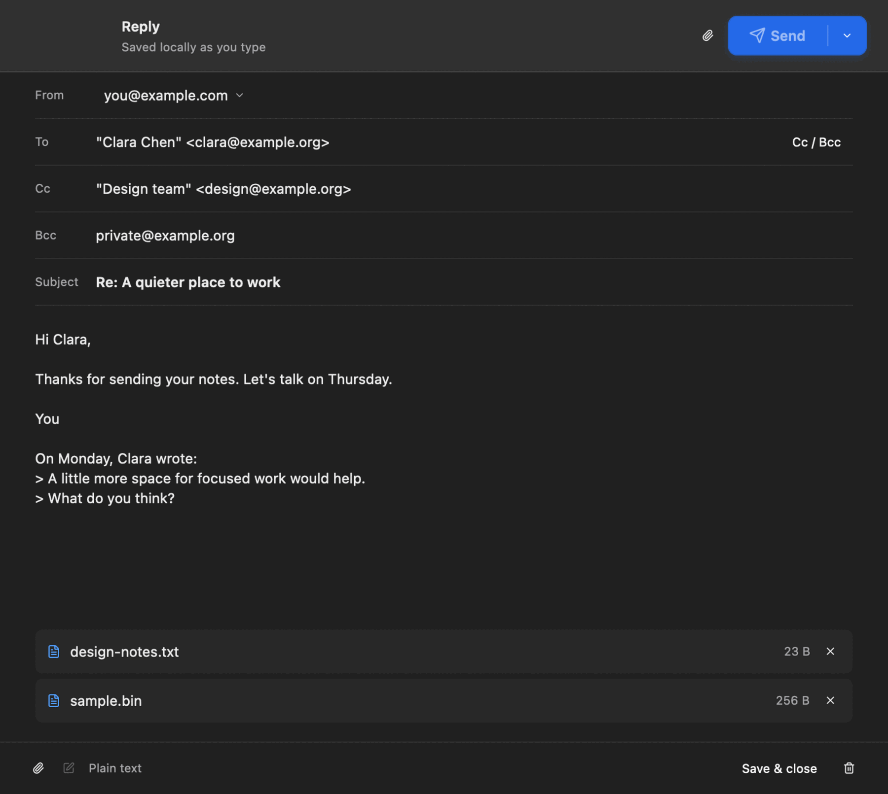
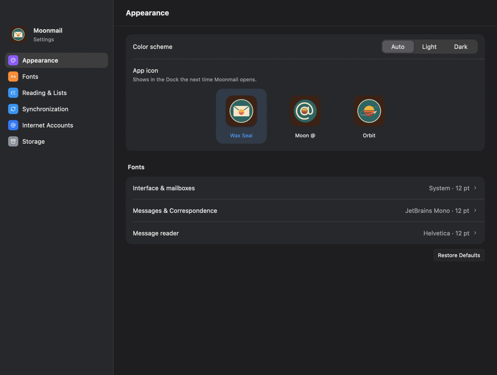
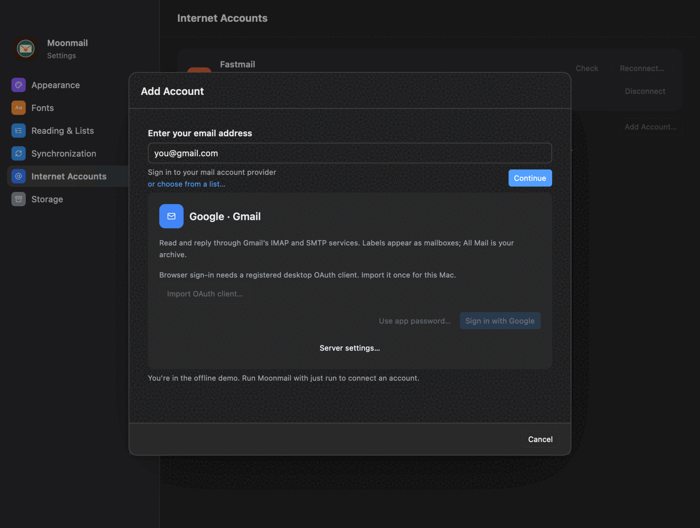
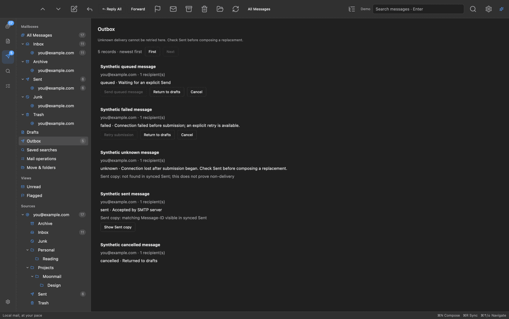
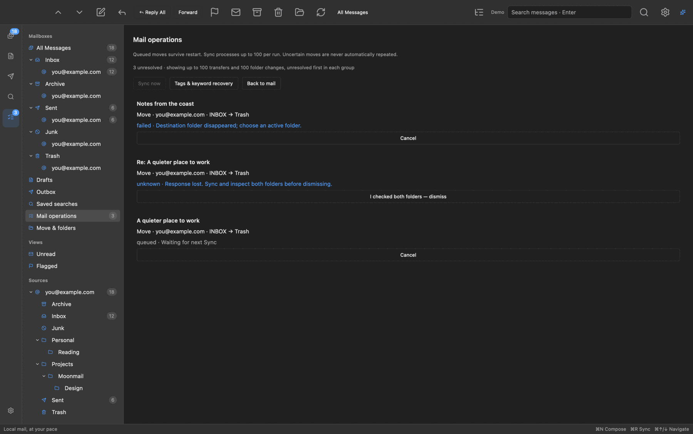

<h1 align="center"><strong>Experimental</strong></h1>

<p align="center">
  
</p>

<h1 align="center">Moonmail</h1>

<p align="center">
  A local-first mail client for macOS, built around Correspondence.<br>
  Your archive stays on your Mac.
</p>

<p align="center">
  <a href="#install"><b>Install</b></a> ·
  <a href="#gallery">Gallery</a> ·
  <a href="#what-it-does">What it does</a> ·
  <a href="#what-it-does-not-do-yet">What it does not do yet</a> ·
  <a href="docs/guide.md">Guide</a>
</p>

Moonmail is a desktop mail client on [Moonframe](https://moonframe.dev), laid
out like MailMate: mailboxes down the side, a dense message list on top,
Correspondence and the reader below. Correspondence shows everything exchanged
with the people on the selected message, separately from its reply thread. It
is not affiliated with MailMate.

## Install

Moonmail has no release yet, so build it from source. You need
[rustup](https://rustup.rs), Xcode Command Line Tools and
[Just](https://just.systems). The first build compiles Moonframe and GPUI and
can take several minutes.

```sh
just demo    # 72 synthetic messages; no network or credentials
just run     # your own archive, in ~/Library/Application Support/moonmail
just debug   # the same, with account logs in target/moonmail-debug.log
just ci
```

## Gallery

<p align="center">
  
  <br>
  <sub><b>The window.</b> Mailboxes, the message list, Correspondence and the reader. Demo data.</sub>
</p>

<table>
  <tr>
    <td width="50%" valign="top">
      
      <br>
      <sub><b>Search.</b> Fields and Boolean operators on a local index.</sub>
    </td>
    <td width="50%" valign="top">
      
      <br>
      <sub><b>Composer.</b> Its own window, so you can keep reading.</sub>
    </td>
  </tr>
  <tr>
    <td width="50%" valign="top">
      
      <br>
      <sub><b>Settings.</b> Laid out like System Settings, with three app icons to pick from.</sub>
    </td>
    <td width="50%" valign="top">
      
      <br>
      <sub><b>Accounts.</b> Enter an address and Moonmail finds the provider.</sub>
    </td>
  </tr>
  <tr>
    <td width="50%" valign="top">
      
      <br>
      <sub><b>Outbox.</b> An uncertain send stays visible and is never retried on its own.</sub>
    </td>
    <td width="50%" valign="top">
      
      <br>
      <sub><b>Mail operations.</b> Every remote change is queued and can be inspected.</sub>
    </td>
  </tr>
</table>

## What it does

- **Accounts**: up to 32, over IMAP and SMTP. Fastmail, Gmail, Microsoft,
  iCloud, Yahoo, AOL and custom servers, with credentials in macOS Keychain.
- **Sync**: folders, flags and keywords, by hand or on a timer, with original
  messages kept byte for byte.
- **Reading**: threads, Correspondence, and sanitized HTML with remote images
  blocked.
- **Search**: fields, Boolean operators, saved searches and partitions, on a
  local index.
- **Writing**: separate composer windows, identities, signatures, attachments
  and a durable outbox that never resends a message on its own.
- **Organizing**: move, copy, archive, tags, folder management and folder-entry
  rules, with every remote change queued and visible.
- **Make it yours**: restyle it in Settings, or ask a coding agent to change it
  while it runs.

## What it does not do yet

- It has not been proven against real accounts: tests use synthetic mail and a
  local mail server, so expect rough edges with your provider.
- It runs on macOS only, and there is no signed release.
- Sign in with Google or Microsoft needs your own imported OAuth client. Gmail
  also works with an app password.
- No IDLE, CONDSTORE or QRESYNC: new mail arrives on Sync or on the timer, and
  it has not been shown to sync a million messages.
- No POP3, Exchange (EWS) or Microsoft Graph, and no Gmail-specific labels.
- Composing is plain text, and drafts stay local.
- Only one composer window at a time.
- Local mail is not encrypted by Moonmail, so rely on disk encryption.

The [guide](docs/guide.md) covers every feature, account setup, limits and
development.

## License

[MIT](LICENSE)
